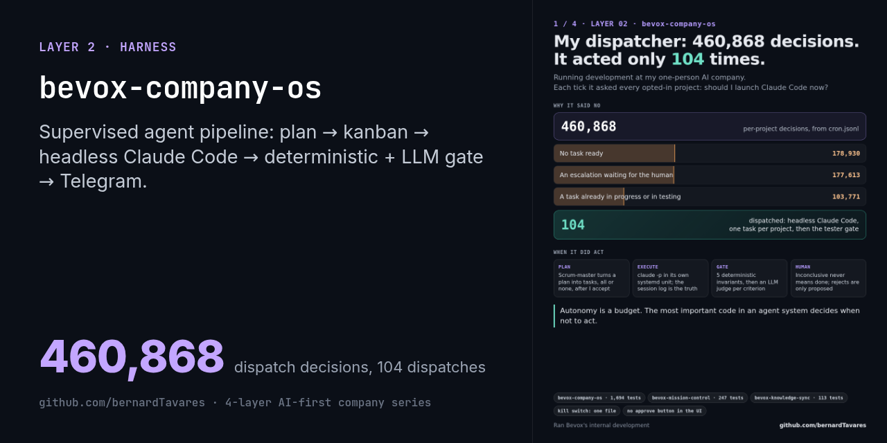
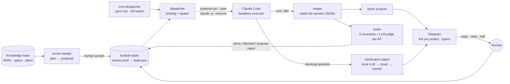
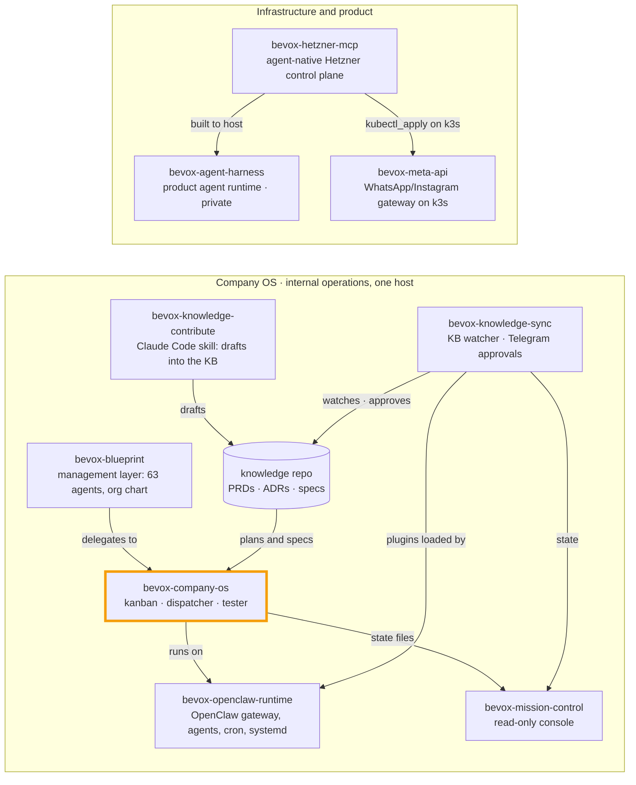

# Bevox Company OS

[](#) [](./LICENSE.md)  



> Part of the [4-layer AI-first company series](https://github.com/bernardTavares) ([how the repos fit together](#how-the-repos-fit-together)). License: FSL-1.1-MIT (source-available, converts to MIT after 2 years)

An operating layer for a one-person AI company. Small supervised agents work as a pipeline:
1. they turn implementation plans into kanban tasks;
2. they launch **headless Claude Code** sessions to execute those tasks;
3. they validate each result with deterministic checks and then an LLM judge;
4. they escalate to the founder on Telegram.

Every step has a kill switch, automation is opt-in, and every mutation leaves an append-only audit trail.

I built it in 2026 to run development at **Bevox**, where it planned, dispatched and validated work across the company's own repos. The doctrine is **"Claude Code codes · OpenClaw operates · the knowledge base decides."**

> **Status:** a prototype that ran in production for Bevox's internal operations. It sits on top of **[OpenClaw](https://openclaw.ai)**, the open-source self-hosted agent gateway, for Telegram, cron, agent sessions and plugins. OpenClaw itself is **not** part of this repo. Everything here is my own code, and it never patches the gateway core.

The read-side UI is a separate repo: **[bevox-mission-control](https://github.com/bernardTavares/bevox-mission-control)**. The OpenClaw configuration it ran on (gateway, agents, cron jobs, systemd units) is in **[bevox-openclaw-runtime](https://github.com/bernardTavares/bevox-openclaw-runtime)**.

## The loop



## Modules

| Module | What it does | Tests |
|---|---|---|
| `kanban-tasks/` | An **event-sourced kanban**. `events.jsonl` is the append-only source of truth and `state.json` is a projection you can rebuild from it, with file locks and atomic writes. A whitelisted state machine moves tasks through `backlog → ready → in_progress → testing → done / rejected`: humans need `--force` to step outside it, agents need `--reason`. Also: per-project sprints, `blocked_by` dependencies that release automatically, and a gate that refuses any task without a spec reference and acceptance criteria. It includes a project factory and a knowledge pipeline (an LLM commit classifier, doc-gap reports, guarded ADR drafts, throttled digests). | 905 |
| `dispatcher-agent/` | Picks the next ready task, writes a briefing, and launches `claude -p` as a detached `systemd-run --user` unit, one task in progress per project. Tasks in the same sprint reuse one Claude session (`--resume`). A **reaper** closes detached loops. The **cron-dispatcher** acts only on opted-in projects. | 173 |
| `tester-agent/` | The gate. It first runs **5 deterministic invariants**, then one read-only `claude -p` check per acceptance criterion (`allowedTools=Read,Grep`). An `inconclusive` result never promotes a task. It can only *propose* a rejection, which a human has to commit. | 37 |
| `clarification-agent/` | When an executing agent hits a blocking question, it asks here. A drafter answers from the canonical docs and attaches a confidence flag: safe answers unblock the task, unsafe ones go to Telegram. It tries a local model (Ollama) first and falls back to the cloud. | 109 |
| `scrum-master-agent/` | Parses a markdown implementation plan into a proposal. Accepting it creates all the tasks or none. | 68 |
| `delivery/`, `health/`, `hardening/`, `cost/`, `finance/` | Delivery tracking and release notes (it proposes diffs, never edits canonical docs unasked). Health checks from a registry. A read-only hardening scanner that never mutates the system and never calls sudo. Cost alerts and a runway view. | 183 · 91 · 67 · 33 · 28 |
| `workspace-template/` | The persona, memory and integration notes each new project agent starts from. |  |
| `docs/superpowers/` | The specs and plans the system was built from. |  |

## Design decisions worth reading

- **Autonomy you can stop.** The cron-dispatcher is default-deny. It touches only opted-in projects, one task per project per tick. It skips a project if anything is in progress, in testing, blocked, or has an open escalation. `touch dispatcher-agent/cron.disabled` stops new dispatches while in-flight work finishes, and every risky feature has its own environment kill switch. In the real logs the gate did most of the work: about 100 dispatches against hundreds of thousands of skips.
- **Determinism before the judge.** About a third of real executions did not auto-promote (`inconclusive` or `fail`). That is the gate working as intended, not noise.
- **Surviving headless CLI quirks.** Three bugs chained into one production incident:
  - `claude -p` sat idle after its final message and never exited;
  - stdout captured by systemd was lost on SIGTERM;
  - a "post-action applied" flag that never reset blocked re-tests.

  The fix reads the Claude **session JSONL** (append-only) as the source of truth instead of stdout. It finalizes idle sessions after 3 minutes and re-invokes with geometric backoff.
- **Process lifecycle.** An end-to-end self-test failed because detached children died with the cron service's cgroup, and an empty log was read as success. Each executor now runs as its own transient systemd unit, and the exit code comes from `systemctl show`, not from parsing logs.
- **Reads never write.** Every mutation leaves a briefing, an execution log, a status file and an event. Commands that only read have no side effects.

## Running the tests

Python 3.11+, stdlib first. Tests need `pytest` and `pyyaml`, and no network or API keys.

```bash
pip install pytest pyyaml requests
for m in kanban-tasks dispatcher-agent clarification-agent scrum-master-agent tester-agent delivery health finance cost hardening; do
  (cd $m && python3 -m pytest tests -q)
done
# 1,694 passed
```

Running the loop for real needs more pieces:
- the repo cloned at `~/.openclaw`;
- an OpenClaw gateway;
- the Claude Code CLI;
- Telegram bots;
- a knowledge-base repo for the specs and plans.

It was built for one Linux host with systemd user services, so read it as a reference design, not a turnkey product.

## How this was built

Every module started as a spec and an implementation plan (`docs/superpowers/`). Claude Code executed each plan with TDD under repo-local rules and skills (`CLAUDE.md`, `.claude/`). After that, the Company OS ran much of its own development through the same loop it describes.

For this public release:
- runtime data (task briefings, escalations, questions, proposals, gateway config and credentials) stayed private;
- hard-coded paths were replaced with the user's home directory;
- six test files written ahead of features that never landed were removed;
- two date-dependent tests were fixed;
- one real bug was fixed: the finance runner ignored its `today` argument.

The docs and many code comments are in Portuguese.

## How the repos fit together

This repo is one piece of Bevox's public code. The repos form two systems: the **Company OS**, which ran Bevox's internal operations on one host on top of OpenClaw, and the **infrastructure** the product was built to run on.



| Repo | Role | Runs with |
|---|---|---|
| [bevox-openclaw-runtime](https://github.com/bernardTavares/bevox-openclaw-runtime) | OpenClaw gateway config, agents (Vox + local Qwen), cron jobs, systemd units | everything in the Company OS runs on it |
| [bevox-company-os](https://github.com/bernardTavares/bevox-company-os) | Supervised agents: plan → kanban → headless Claude Code → tester → Telegram | runtime, mission-control, knowledge-sync |
| [bevox-mission-control](https://github.com/bernardTavares/bevox-mission-control) | Read-only web console over the Company OS state (fork of TenacitOS) | company-os, knowledge-sync |
| [bevox-knowledge-sync](https://github.com/bernardTavares/bevox-knowledge-sync) | Knowledge-repo watcher + OpenClaw plugins for approvals on Telegram | runtime, knowledge-contribute |
| [bevox-knowledge-contribute](https://github.com/bernardTavares/bevox-knowledge-contribute) | Claude Code skill that writes PRDs, ADRs and specs as draft branches | knowledge-sync |
| [bevox-blueprint](https://github.com/bernardTavares/bevox-blueprint) | Management layer: 63 Claude Code agents, org chart, RACI, OKRs | company-os |
| [bevox-hetzner-mcp](https://github.com/bernardTavares/bevox-hetzner-mcp) | MCP server + REST control plane for Hetzner Cloud with an approval gate | built to host the agent harness; manages meta-api's k3s |
| [bevox-meta-api](https://github.com/bernardTavares/bevox-meta-api) | Multi-tenant WhatsApp/Instagram gateway that ran in production on k3s | hetzner-mcp |
| bevox-agent-harness (private for now) | The product's agent runtime. It never carried production traffic. | hetzner-mcp |

## License

[Functional Source License 1.1, MIT Future License](./LICENSE.md) (FSL-1.1-MIT). Copyright 2026 Bernard Tavares.

You may use, modify and redistribute it for any purpose except a competing commercial product or service. Each version becomes MIT-licensed two years after its release. OpenClaw is a separate project under its own license.
